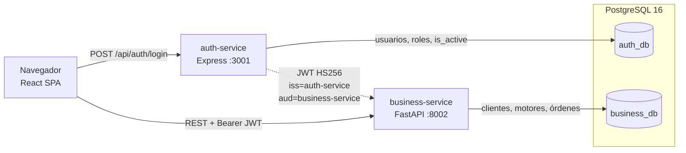
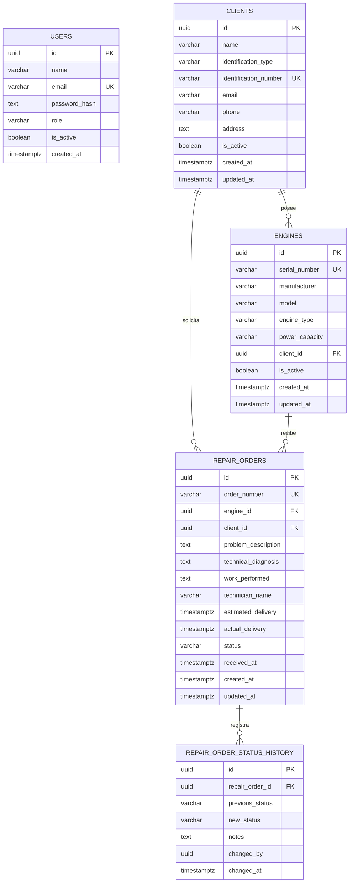
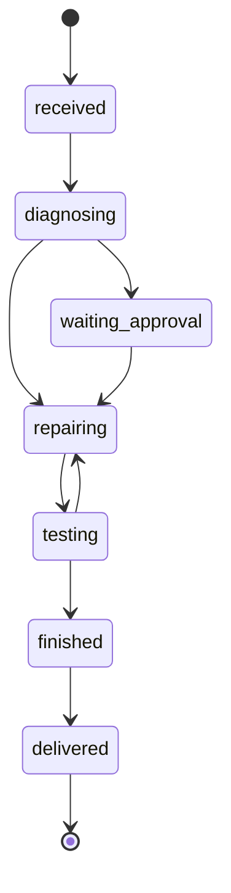
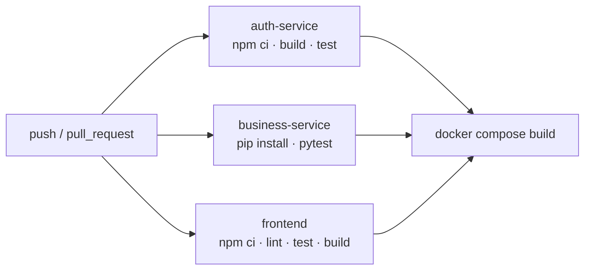

# Mining Engine RMS

Sistema de gestión de reparaciones de motores de minería. El repositorio contiene dos servicios backend independientes, una SPA y una única instancia de PostgreSQL con dos bases lógicas aisladas.

## Stack

| Capa | Tecnología |
| --- | --- |
| Autenticación | Node.js 22, Express 5, TypeScript, Prisma 7, bcryptjs, JWT |
| Negocio | Python 3.13, FastAPI, SQLAlchemy 2, Pydantic, PyJWT |
| Frontend | React 19, TypeScript, Vite 8, Tailwind CSS 4, React Router 7 |
| Base de datos | PostgreSQL 16 (dos bases lógicas) |
| Infraestructura | Docker multi-stage, Docker Compose, Nginx |
| Pruebas | Vitest + Supertest, pytest + TestClient, Vitest + Testing Library |
| CI | GitHub Actions |

## Arquitectura



- El frontend nunca valida credenciales por su cuenta: delega en `auth-service`.
- `auth-service` es la única fuente de identidad y emite el JWT.
- `business-service` valida firma, expiración, emisor y audiencia del mismo JWT, pero no consulta la base de autenticación.
- Cada servicio usa un usuario técnico distinto. `auth_user` no puede conectarse a `business_db` y viceversa.

## Modelo de datos



`changed_by` guarda el claim `sub` del JWT; no es una clave foránea porque la identidad vive en otra base.

## Flujo de estados



Reglas aplicadas en el servicio de negocio:

- No se permite repetir el estado actual.
- No se permiten saltos fuera del grafo anterior.
- Cada transición inserta un registro append-only en `repair_order_status_history`.
- Al pasar a `delivered` se completa `actual_delivery` si el cliente no lo envió.

## Estructura

```text
.
├── auth-service/           Express + Prisma (identidad, JWT, usuarios)
│   ├── prisma/             Esquema y migraciones
│   ├── src/                Código fuente
│   └── test/               Vitest + Supertest
├── business-service/       FastAPI + SQLAlchemy (clientes, motores, órdenes)
│   ├── app/                API, modelos, repositorios, servicios
│   └── tests/              pytest + TestClient
├── frontend/               React SPA
│   └── src/                lib, context, hooks, components, pages
├── database/init.sh        Creación de usuarios y bases lógicas desde variables de entorno
├── docker-compose.yml      Postgres + los tres servicios
└── .github/workflows/ci.yml
```

## Requisitos

- Docker Desktop o Docker Engine con Compose v2 (recomendado).
- Alternativa local: Node.js 22+, Python 3.13+ y PostgreSQL 16.
- Git.

## Inicio rápido con Docker

```bash
cp .env.example .env
# Ajustar credenciales si no se usan los valores de desarrollo
docker compose up --build
```

`docker compose` requiere el archivo `.env`: las contraseñas de las bases, `JWT_SECRET` y `ADMIN_PASSWORD` no tienen valores por defecto en el compose. Si falta alguna, Compose detiene el arranque con un mensaje indicando la variable requerida.

| Recurso | URL |
| --- | --- |
| Frontend | http://localhost:5173 |
| Auth service | http://localhost:3001/health |
| Swagger auth | http://localhost:3001/api-docs/ |
| Business service | http://localhost:8002/health |
| Swagger business | http://localhost:8002/docs |
| PostgreSQL | `localhost:5432` |

Con los valores de `.env.example`, las credenciales sembradas al iniciar son:

```text
admin@test.com / 123456
```

`ADMIN_EMAIL` y `ADMIN_PASSWORD` se pueden cambiar en el `.env` raíz.

El contenedor de autenticación aplica `prisma migrate deploy` y ejecuta un seed idempotente antes de arrancar Express. El contenedor de negocio crea sus tablas al importar la aplicación.

Variables principales del archivo `.env` raíz:

| Variable | Obligatoria | Uso |
| --- | --- | --- |
| `POSTGRES_DB`, `POSTGRES_USER` | No | Base y superusuario iniciales de PostgreSQL |
| `POSTGRES_PASSWORD` | Sí | Contraseña del superusuario de PostgreSQL |
| `AUTH_DB_NAME`, `AUTH_DB_USER` | No | Base lógica y usuario técnico de auth-service |
| `AUTH_DB_PASSWORD` | Sí | Contraseña del usuario técnico de auth-service |
| `BUSINESS_DB_NAME`, `BUSINESS_DB_USER` | No | Base lógica y usuario técnico de business-service |
| `BUSINESS_DB_PASSWORD` | Sí | Contraseña del usuario técnico de business-service |
| `JWT_SECRET` | Sí | Secreto HS256 compartido; mínimo 32 bytes |
| `ADMIN_NAME`, `ADMIN_EMAIL` | No | Datos del administrador inicial |
| `ADMIN_PASSWORD` | Sí | Contraseña del administrador inicial |
| `VITE_AUTH_API_URL` | No | URL del auth-service compilada en el frontend |
| `VITE_BUSINESS_API_URL` | No | URL del business-service compilada en el frontend |

Los valores de `.env.example` son solo para desarrollo. En un entorno real se deben reemplazar todas las contraseñas y el secreto, y servir todo por HTTPS. El `.env` real está ignorado por Git.

### Generación y configuración del secreto

```bash
openssl rand -hex 32
```

- **Local:** copiar el valor en `auth-service/.env` y `business-service/.env`; debe ser idéntico en ambos porque HS256 firma y verifica con la misma clave.
- **Docker Compose:** definirlo en el `.env` raíz; Compose lo inyecta en los dos contenedores.
- **CI/CD:** las pruebas backend definen su propio secreto de pruebas en `setup`/`conftest`; el workflow no contiene un secreto real. Para un despliegue real, definir `JWT_SECRET` como GitHub Actions secret o variable del proveedor y no versionarlo.

El algoritmo está fijado en `HS256` en el código de ambos servicios; no se toma de una variable de entorno. `auth-service` firma con `iss=auth-service` y `aud=business-service`, y ambos servicios validan explícitamente el algoritmo, el emisor, la audiencia y la expiración. El secreto debe tener al menos 32 bytes; un valor más corto impide el arranque.

Se eligió HS256 porque hay un único emisor, dos servicios internos y un secreto compartido que nunca llega al frontend; es suficiente para el alcance de la prueba y evita la gestión de claves asimétricas. RS256 sería una mejora válida si se quisiera separar la capacidad de firma de la de verificación.

Para rotar el secreto se debe cambiar el valor en `auth-service` y `business-service` a la vez. Los tokens emitidos antes del cambio dejan de ser válidos y los usuarios deben iniciar sesión de nuevo.

### Inicialización de PostgreSQL

`database/init.sh` se ejecuta automáticamente la primera vez que se crea el volumen. Lee `AUTH_DB_*` y `BUSINESS_DB_*` del entorno, crea las dos bases y sus usuarios técnicos, y aísla el acceso entre ellas. El script usa `psql` con `\getenv` para no incrustar credenciales en SQL.

Un volumen ya inicializado **no vuelve a ejecutar** el script. Si se cambian nombres o contraseñas, hay que recrear el volumen (destructivo):

```bash
docker compose down -v
docker compose up --build
```

Las contraseñas se insertan en las URLs de conexión; si contienen caracteres especiales como `@`, `:` o `/`, deben ser URL-safe o percent-encoded.

## Desarrollo local

### 1. PostgreSQL

```bash
docker compose up -d postgres
```

`database/init.sh` crea las bases y usuarios técnicos definidos en el `.env` raíz la primera vez que se inicializa el volumen. Las credenciales de `auth-service/.env` y `business-service/.env` deben coincidir con ese `.env` cuando se trabaja en local.

### 2. Auth service

```bash
cd auth-service
cp .env.example .env
npm install
npx prisma migrate deploy
npm run seed
npm run dev
```

### 3. Business service

Windows:

```bash
cd business-service
python -m venv .venv
.venv/Scripts/activate
pip install -r requirements.txt
cp .env.example .env
uvicorn app.main:app --reload --port 8002
```

Linux/macOS:

```bash
cd business-service
python -m venv .venv
source .venv/bin/activate
pip install -r requirements.txt
cp .env.example .env
uvicorn app.main:app --reload --port 8002
```

### 4. Frontend

```bash
cd frontend
npm install
cp .env.example .env
npm run dev
```

## API

Todas las rutas del business-service (excepto `/health`) requieren `Authorization: Bearer <jwt>`.

### Auth service

| Método | Ruta | Acceso | Descripción |
| --- | --- | --- | --- |
| POST | `/api/auth/register` | Público | Registra un usuario (`operator` por defecto) |
| POST | `/api/auth/login` | Público | Devuelve usuario y tokens |
| GET | `/api/auth/me` | Autenticado | Usuario del token |
| GET | `/api/users` | Admin | Lista usuarios |
| GET | `/api/users/{id}` | Admin | Consulta usuario |
| PATCH | `/api/users/{id}` | Admin | Actualiza datos, rol o estado |
| PATCH | `/api/users/{id}/role` | Admin | Cambia el rol |
| PATCH | `/api/users/{id}/deactivate` | Admin | Desactiva |
| PATCH | `/api/users/{id}/activate` | Admin | Reactiva |

Un administrador no puede desactivarse ni quitarse el rol a sí mismo.

### Business service

| Método | Ruta | Descripción |
| --- | --- | --- |
| GET | `/health` | Estado del servicio (público) |
| POST/GET | `/clients/` | Crea / lista clientes |
| GET/PUT/DELETE | `/clients/{id}` | Consulta / actualiza / elimina |
| POST/GET | `/engines/` | Crea / lista motores (`?client_id=`) |
| GET/PUT/DELETE | `/engines/{id}` | Consulta / actualiza / elimina |
| POST/GET | `/repair-orders/` | Crea / lista órdenes |
| GET | `/repair-orders/{id}` | Detalle con cliente y motor |
| PATCH | `/repair-orders/{id}/status` | Cambia estado y registra historial |
| GET | `/repair-orders/{id}/history` | Historial de estados |

Filtros del listado de órdenes: `status`, `client_id`, `engine_id` y `search` (número de orden, serial del motor o nombre del cliente). También acepta `skip` y `limit`.

Borrados protegidos: no se elimina un cliente con motores ni un motor con órdenes.

## Pruebas

```bash
# Auth: 14 pruebas
cd auth-service && npm test

# Business: 10 pruebas
cd business-service && python -m pytest

# Frontend: 18 pruebas
cd frontend && npm test
```

- **Auth:** aprovisiona `auth_test_db` con `mining_user`, aplica las migraciones SQL y limpia `users` antes de cada prueba. Cubre registro, validación, login, claims del JWT, `/me`, autorización por rol, desactivación, auto-protección del administrador y rechazo de algoritmos o emisores incorrectos.
- **Business:** aprovisiona `business_test_db` antes de importar la app y trunca las tablas antes de cada prueba. Cubre CRUD, duplicados, referencias, filtros, búsqueda, transiciones válidas e inválidas, historial, guardas de borrado y rechazo de tokens inválidos, expirados, con emisor o algoritmo incorrectos.
- **Frontend:** Vitest + Testing Library + jsdom. Cubre formato, estados, badges, guardas de ruta y login (validación, envío y error de API).

Requisito para las pruebas backend: PostgreSQL disponible en `localhost:5432` con el usuario `mining_user` (por ejemplo, `docker compose up -d postgres`). Las bases de prueba se crean automáticamente y no tocan `auth_db` ni `business_db`. Si se cambia la contraseña de `mining_user`, definir `TEST_ADMIN_DATABASE_URL` y `TEST_DATABASE_URL` antes de ejecutar las pruebas.

## CI



Cada job usa su propio PostgreSQL 16 como service container. El job final crea un `.env` temporal desde `.env.example`, valida la configuración y compila las tres imágenes para detectar errores de empaquetado.

## Decisiones de diseño

- **Dos servicios, dos bases lógicas:** separa el ciclo de vida de identidad y negocio. Los usuarios técnicos no tienen acceso cruzado.
- **JWT compartido con HS256:** evita llamadas sincrónicas entre servicios en cada request. El algoritmo está fijado y el secreto se valida al arrancar. El costo es que una desactivación tarda como máximo lo que reste del token en el business-service; `auth-service` sí revalida contra la base en cada request autenticado.
- **Historial append-only:** conserva trazabilidad completa de cada transición, incluyendo notas y autor.
- **Reglas en el servicio, no en la base:** las transiciones se validan en Python para devolver errores claros. La base mantiene constraints de unicidad y claves foráneas.
- **Sin librería de estado en el frontend:** el estado de sesión vive en un contexto pequeño y los datos se obtienen con `fetch`. Es suficiente para el alcance y reduce dependencias.
- **Migraciones en el arranque:** el contenedor de auth ejecuta `prisma migrate deploy` con reintentos y luego un seed idempotente; facilita `docker compose up --build`.
- **Nginx para la SPA:** fallback a `index.html`, cache de assets y endpoint `/health`.
- **Pruebas con bases reales:** PostgreSQL en lugar de SQLite para respetar UUID, `timestamptz` y constraints reales.

## Seguridad y limitaciones

- Contraseñas con bcrypt (costo 10); nunca se serializa `password_hash`.
- Las credenciales de bases de datos viven en `.env`; `docker-compose.yml` solo las referencia y no contiene contraseñas literales.
- El secreto JWT es obligatorio, de al menos 32 bytes y nunca tiene un valor por defecto en el backend. Solo se acepta el algoritmo HS256 y se validan emisor y audiencia.
- Validación de entrada con Zod y Pydantic; errores de validación con detalle por campo.
- Roles `admin` y `operator`; las rutas de administración están protegidas en backend y en el frontend.
- El registro público está disponible por requisito. El frontend no expone creación de usuarios: solo el administrador gestiona roles y estado.
- CORS está abierto para facilitar la demo; restringirlo a los orígenes reales en producción.
- No hay refresh token ni revocación distribuida. El token dura una hora y el business-service no consulta sesiones.
- Las tablas del business-service se crean con `metadata.create_all`; para evolución de esquema en producción convendría incorporar Alembic.
- No se implementaron eliminación de clientes/motores desde la interfaz ni edición de órdenes: la API las soporta según el alcance, pero la UI prioriza el flujo operativo.
- Las URL de las APIs del frontend se resuelven en tiempo de compilación. Si cambian, se debe reconstruir la imagen.
